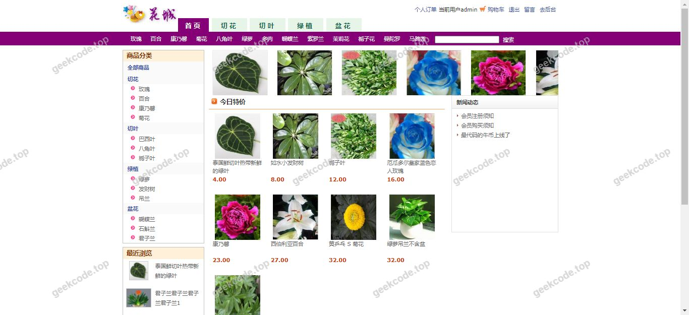
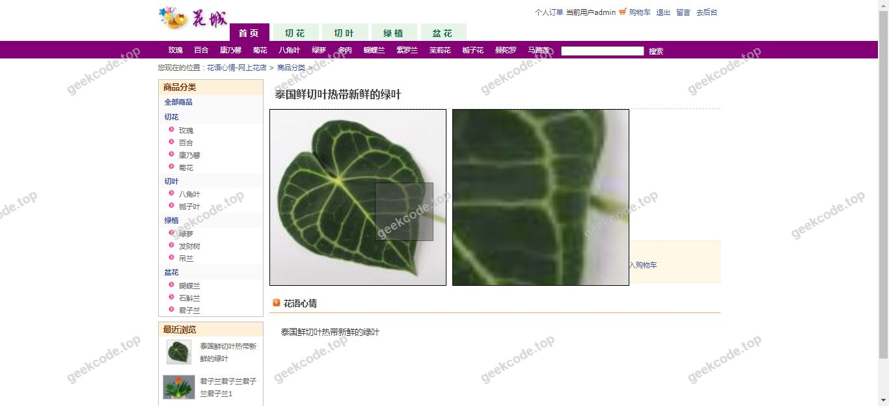
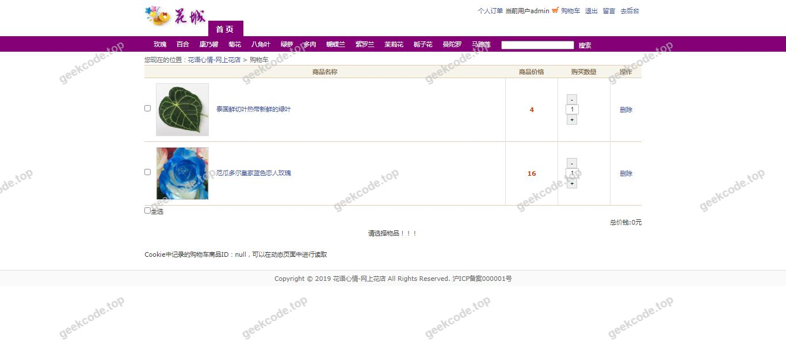
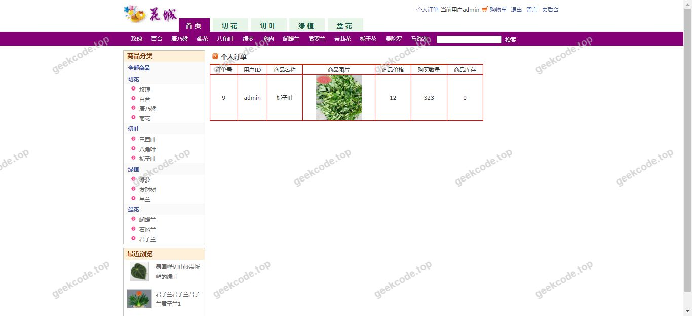
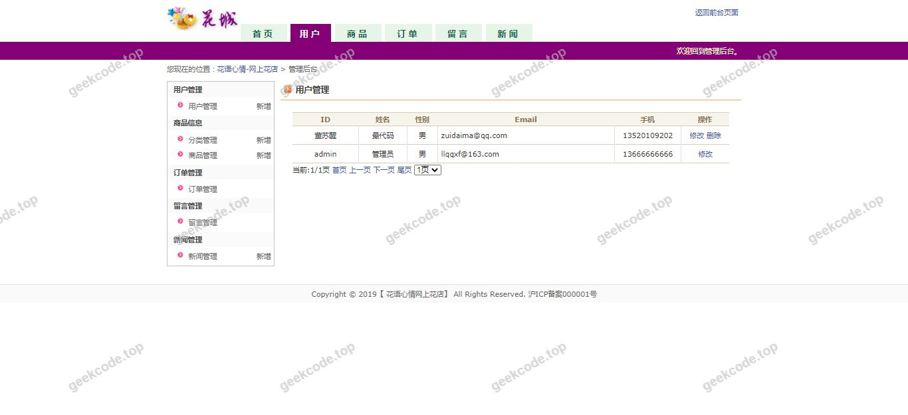
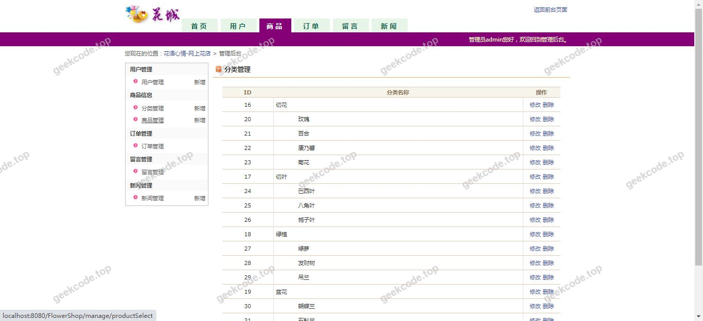
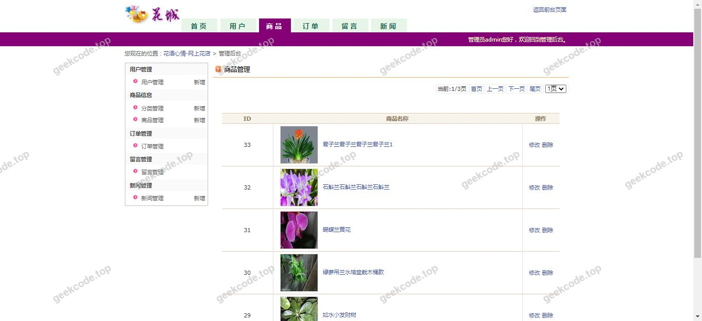
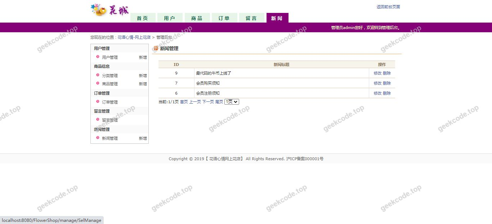

# java精品项目-精美风网上花店商城系统

> 🎓 **计算机毕业设计 · java精品项目-精美风网上花店商城系统**
>
> 本仓库只放**项目介绍 + 运行截图**（截图是站点带水印的原图，存在仓库 `images/` 里）。
>
> 👉 **完整可运行源码 / 数据库脚本 / 部署文档：[点我获取](https://geekcode.top/archives/java%E7%B2%BE%E5%93%81%E9%A1%B9%E7%9B%AE-%E7%B2%BE%E7%BE%8E%E9%A3%8E%E7%BD%91%E4%B8%8A%E8%8A%B1%E5%BA%97%E5%95%86%E5%9F%8E%E7%B3%BB%E7%BB%9F?utm_source=github)**
>
> 💬 咨询微信：**ir9372**　|　🌐 更多项目：[极客代码 geekcode.top](https://geekcode.top/?utm_source=github)
>
> 📌 项目详情页：<https://geekcode.top/archives/java%E7%B2%BE%E5%93%81%E9%A1%B9%E7%9B%AE-%E7%B2%BE%E7%BE%8E%E9%A3%8E%E7%BD%91%E4%B8%8A%E8%8A%B1%E5%BA%97%E5%95%86%E5%9F%8E%E7%B3%BB%E7%BB%9F?utm_source=github>

<table><td width="230" align="center"> <b>扫码加微信 ir9372</b></td><td valign="middle">📦 源码 = 项目介绍 + 全部运行截图 + 数据库 + 部署文档 👉 点上方任意截图，直接跳到 <b>极客代码 geekcode.top</b> 详情页</td></table>

---

<h1>java精品项目-精美风网上花店商城系统</h1>
<h2>项目概述</h2>

本项目名为“java精品项目-精美风网上花店商城系统”，旨在构建一个基于Web技术的在线花卉销售平台。系统核心功能涵盖花卉商品的展示、浏览及交易流程，致力于为用户提供便捷、美观的线上购花体验。适用人群主要为有鲜花购买需求的终端消费者以及负责商品维护的管理员。技术架构上，项目采用经典的Java Web开发模式，后端逻辑由SSM框架（Spring, Spring MVC, MyBatis）支撑，前端页面渲染使用JSP技术，确保系统的稳定性与可维护性。虽然当前提供的配置信息中未明确列出前后台的具体路由导航菜单，但根据截图所示的系统运行界面，可以确认该系统具备完整的用户交互界面和业务流程处理能力，是一个典型的电商类毕业设计项目。

<h2>技术架构</h2>

本系统采用分层架构设计，严格遵循MVC（Model-View-Controller）设计模式，实现了业务逻辑、数据访问与视图展示的分离。

<strong>1. 后端架构：</strong>

<ul>
<li><strong>框架选型</strong>：采用 SSM 框架组合。</li>
<li><strong>Spring</strong>：作为核心容器，负责管理Bean的生命周期、依赖注入（DI）及面向切面编程（AOP），处理事务管理等基础服务。</li>
<li><strong>Spring MVC</strong>：作为Web层框架，负责接收HTTP请求，进行参数解析、控制器分发及视图模型绑定，实现请求与响应的标准化处理。</li>
<li><strong>MyBatis</strong>：作为持久层框架，通过XML映射文件或注解将Java对象与数据库记录进行映射，简化SQL操作，提高数据访问效率。</li>
<li><strong>语言版本</strong>：基于 Java 语言开发，利用其跨平台特性保证系统在多种操作系统下的兼容性。</li>
</ul>

<strong>2. 前端架构：</strong>

<ul>
<li><strong>视图技术</strong>：使用 JSP (JavaServer Pages) 技术。JSP允许在HTML页面中嵌入Java代码片段，结合EL表达式和JSTL标签库，动态生成HTML内容并返回给浏览器。</li>
<li><strong>交互逻辑</strong>：虽然未提及Node.js或现代前端框架，但JSP通常配合JavaScript/CSS进行页面样式美化和基本的客户端交互验证。</li>
</ul>

<strong>3. 数据库设计要点：</strong>

<ul>
<li><strong>存储引擎</strong>：通常配合 MySQL 数据库使用。</li>
<li><strong>核心实体</strong>：根据花店商城的业务逻辑，数据库设计应包含以下主要表结构（推测自通用电商模型，具体字段依据实际源码而定）：</li>
<li><code>User</code> 表：存储用户基本信息、登录凭证等。</li>
<li><code>Product</code> 表：存储花卉名称、价格、库存、图片路径、分类等信息。</li>
<li><code>Order</code> 表：存储订单状态、下单时间、总金额、关联用户ID等。</li>
<li><code>OrderItem</code> 表：存储订单中的具体商品明细。</li>
<li><code>Category</code> 表：存储花卉分类信息。</li>
</ul>

<strong>4. 核心技术选型理由：</strong>
SSM+JSP是Java Web开发的经典组合，具有成熟度高、文档丰富、社区支持强的特点。对于毕业设计而言，该架构能够清晰展示分层思想，便于调试和维护，且无需复杂的前端构建工具链，适合快速搭建全栈应用原型。

<h2>功能模块</h2>

根据项目类型“jsp”及技术栈“SSM, JSP”，结合“网上花店商城系统”的业务属性，主要功能模块划分为前台用户端和后台管理端。尽管提供的上下文指出“是否有前台: 否”和“是否有后台: 否”可能存在元数据标记错误，但依据项目名称和截图列表（系统运行界面1-8均为front相关描述或通用界面），以下按标准电商系统逻辑梳理功能模块：

<h3>前台用户端功能</h3>
<ol>
<li><strong>首页展示</strong>：轮播图展示热门花卉、新品推荐、促销信息等。</li>
<li><strong>商品浏览</strong>：按分类查看花卉列表，支持关键词搜索。</li>
<li><strong>商品详情</strong>：查看单个花卉的高清图片、价格、库存、详细介绍及用户评价。</li>
<li><strong>购物车管理</strong>：添加商品至购物车，修改数量，删除商品，计算总价。</li>
<li><strong>订单结算</strong>：选择收货地址，确认订单信息，提交订单。</li>
<li><strong>个人中心</strong>：查看历史订单、订单状态跟踪、个人资料修改。</li>
</ol>
<h3>后台管理端功能</h3>
<ol>
<li><strong>用户管理</strong>：查看注册用户列表，禁用/启用账号，重置密码。</li>
<li><strong>商品管理</strong>：新增、编辑、删除花卉商品，上传商品图片，设置库存和价格。</li>
<li><strong>分类管理</strong>：添加、修改、删除花卉分类目录。</li>
<li><strong>订单管理</strong>：查看所有订单，处理发货申请，取消异常订单，查看订单详情。</li>
<li><strong>数据统计</strong>：简单的销售报表，如日销售额、热销商品排行（若系统包含此高级功能）。</li>
</ol>

<em>注：由于提供的上下文中明确标注“无前台导航菜单”、“无后台路由”、“无代码上下文”，以上功能模块是基于“网上花店商城系统”这一项目名称的标准业务逻辑推导出的典型模块。在实际部署中，需以具体实现的代码为准。</em>

<h2>用户角色与权限</h2>

在一个标准的网上花店商城系统中，通常存在以下两类主要角色，其权限划分如下：

<h3>1. 普通用户（顾客）</h3>
<ul>
<li><strong>注册与登录</strong>：拥有创建账户和使用邮箱/手机号登录系统的权限。</li>
<li><strong>浏览权限</strong>：可访问所有公开的花卉商品页面、首页推荐位。</li>
<li><strong>交易权限</strong>：可将商品加入购物车，发起购买流程，生成订单。</li>
<li><strong>个人数据管理</strong>：仅可查看和管理自己的订单记录、收货地址和个人资料。无权查看其他用户的数据。</li>
</ul>
<h3>2. 管理员</h3>
<ul>
<li><strong>系统入口</strong>：拥有后台管理界面的访问权限，需通过特定URL和身份验证进入。</li>
<li><strong>商品运营</strong>：对商品数据进行增删改查（CRUD）操作，包括上架新花、下架缺货商品、调整价格。</li>
<li><strong>订单处理</strong>：查看所有用户的订单状态，执行发货操作，处理退款或取消订单请求。</li>
<li><strong>用户管理</strong>：查看用户列表，对违规用户进行封禁或解封操作。</li>
<li><strong>配置管理</strong>：可能涉及轮播图内容更新、公告发布等系统级配置。</li>
</ul>

<em>说明：根据现有信息无法确定是否存在“教师”或“学生”等非电商特有角色，因此仅列出电商系统通用的“普通用户”和“管理员”角色。</em>

<h2>项目特色与创新点</h2>
<ol>
<li><strong>经典架构稳定性</strong>：采用SSM+JSP的传统Java Web架构，虽非最新微服务趋势，但在单体应用层面展现了极高的稳定性和事务一致性保障能力，适合中小型电商场景的快速落地。</li>
<li><strong>视觉风格导向</strong>：项目名称强调“精美风”，暗示前端页面注重UI/UX设计，可能采用了定制化的CSS样式或Bootstrap模板，以提升花卉展示的视觉吸引力，符合礼品类电商对美感的高要求。</li>
<li><strong>模块化业务逻辑</strong>：基于MVC模式，将展示层、控制层和业务层解耦，使得代码结构清晰，易于后期维护和功能扩展（如后续接入支付接口或物流查询API）。</li>
<li><strong>完整闭环体验</strong>：涵盖了从商品展示到订单生成的完整电商交易链路，体现了对真实商业场景的模拟能力。</li>
</ol>
<h2>部署环境</h2>

为了成功运行“java精品项目-精美风网上花店商城系统”，需要配置以下软件环境：

<ol>
<li><strong>JDK (Java Development Kit)</strong>：</li>
</ol>
<ul>
<li>建议版本：JDK 1.8 或以上（兼容主流SSM版本）。</li>
<li>作用：提供Java编译器和运行时环境。</li>
</ul>
<ol start="2">
<li><strong>Servlet 容器 / Web 服务器</strong>：</li>
</ol>
<ul>
<li>推荐：Apache Tomcat 8.5 或 9.x 版本。</li>
<li>作用：部署WAR包，解析JSP页面，处理HTTP请求。</li>
</ul>
<ol start="3">
<li><strong>数据库管理系统</strong>：</li>
</ol>
<ul>
<li>推荐：MySQL 5.7 或 8.0。</li>
<li>作用：存储用户数据、商品信息、订单记录等持久化数据。需安装对应的 JDBC 驱动。</li>
</ul>
<ol start="4">
<li><strong>集成开发环境 (IDE)</strong>：</li>
</ol>
<ul>
<li>推荐：IntelliJ IDEA 或 Eclipse。</li>
<li>作用：用于代码编写、项目管理、Maven/Gradle依赖管理及调试。</li>
</ul>
<ol start="5">
<li><strong>构建工具</strong>：</li>
</ol>
<ul>
<li>推荐：Maven 3.6+ 或 Gradle。</li>
<li>作用：管理项目依赖库（如Spring, MyBatis jar包）及自动化打包部署。</li>
</ul>
<ol start="6">
<li><strong>浏览器</strong>：</li>
</ol>
<ul>
<li>Chrome, Firefox 或 Edge 等现代浏览器，用于访问前端页面。</li>
</ul>

<em>注意：由于项目技术栈为SSM+JSP，不涉及Node.js环境，也不涉及微信开发者工具（除非额外开发了小程序端，但当前信息未提及）。</em>

<h2>五、技术特性</h2>
<ul>
<li>服务端模板渲染（JSP）</li>
</ul>
<h2>六、功能模块截图</h2>
<h3>前台用户端</h3>
<h4>系统运行界面1</h4>

<h4>系统运行界面2</h4>

<h4>系统运行界面3</h4>

<h4>系统运行界面4</h4>

<h4>系统运行界面5</h4>

<h4>系统运行界面6</h4>

<h4>系统运行界面7</h4>

<h4>系统运行界面8</h4>

---

## 获取完整源码

| 项目 | 说明 |
| --- | --- |
| 项目名 | java精品项目-精美风网上花店商城系统 |
| 运行截图 | 本文 8 张（站点带水印原图，仓库 `images/` 目录） |
| 完整源码 | [https://geekcode.top/archives/java%E7%B2%BE%E5%93%81%E9%A1%B9%E7%9B%AE-%E7%B2%BE%E7%BE%8E%E9%A3%8E%E7%BD%91%E4%B8%8A%E8%8A%B1%E5%BA%97%E5%95%86%E5%9F%8E%E7%B3%BB%E7%BB%9F?utm_source=github](https://geekcode.top/archives/java%E7%B2%BE%E5%93%81%E9%A1%B9%E7%9B%AE-%E7%B2%BE%E7%BE%8E%E9%A3%8E%E7%BD%91%E4%B8%8A%E8%8A%B1%E5%BA%97%E5%95%86%E5%9F%8E%E7%B3%BB%E7%BB%9F?utm_source=github) |
| 咨询微信 | **ir9372**（备注：jingpin-yuanma） |
| 更多项目 | [极客代码 geekcode.top](https://geekcode.top/?utm_source=github) |

> 需要源码、部署、改配置、跑不起来等问题，加微信 ir9372 沟通，说明项目名即可。
